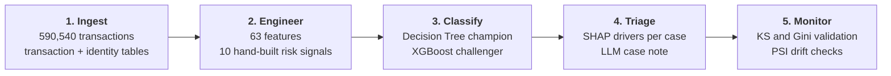
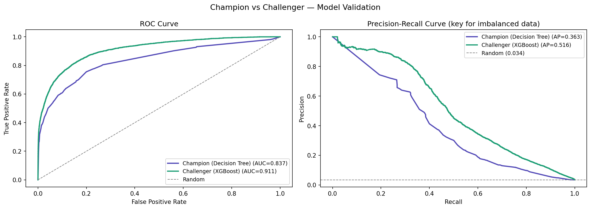
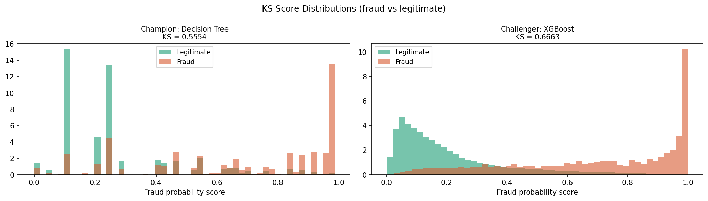
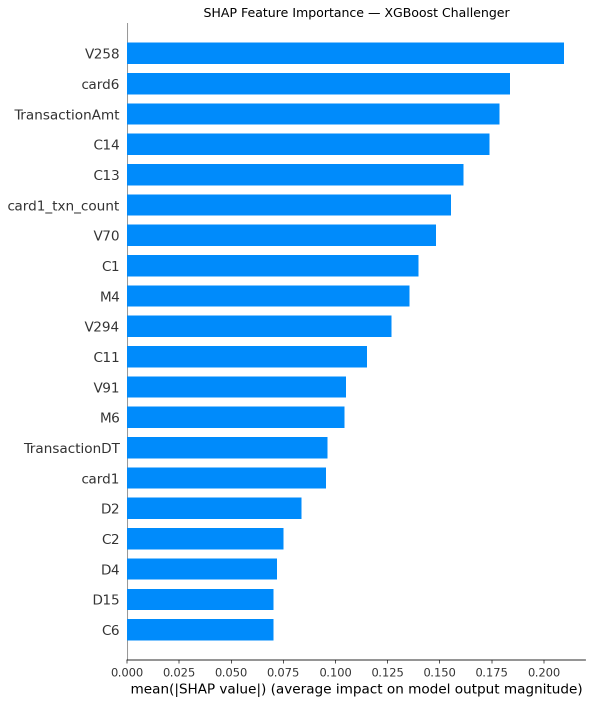
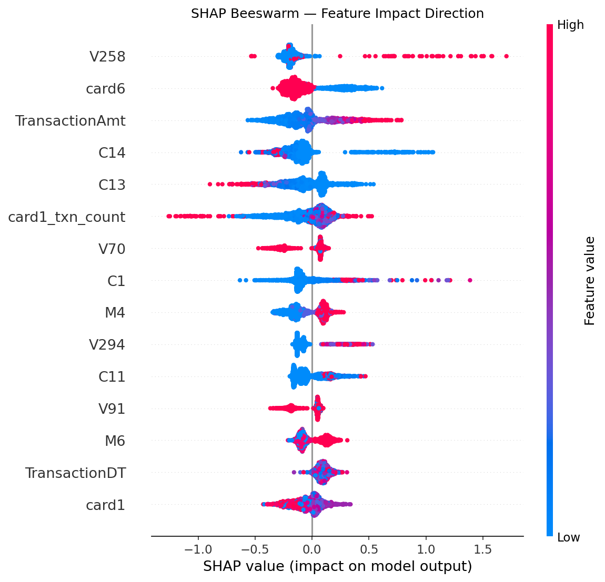
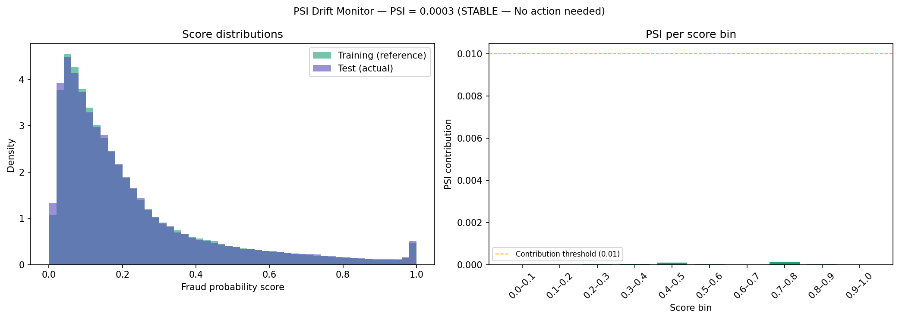
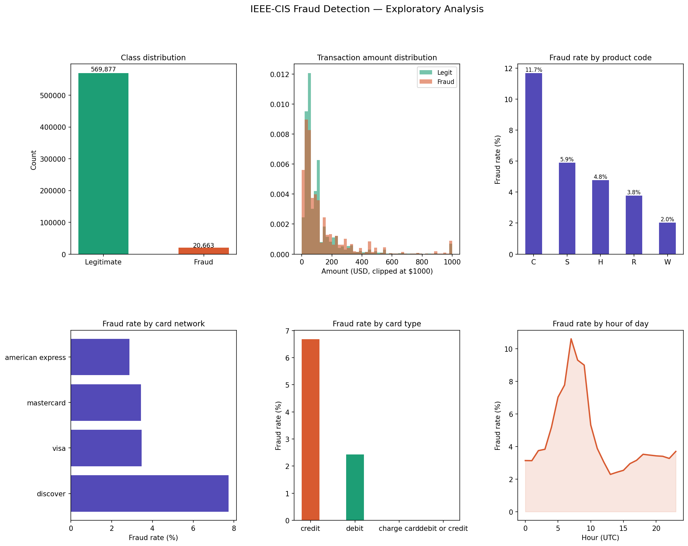

# Enterprise Fraud Risk Intelligence System

**Every card payment gets a fraud score, a reason, and a next step.**

A fraud detection pipeline trained on 590,540 real e-commerce transactions (IEEE-CIS / Vesta). It scores payments with XGBoost, explains each score with SHAP, drafts the analyst's case note with an LLM, and monitors itself for drift. The whole thing is structured the way a bank's model risk team would expect under SR 11-7.

[**Live demo**](https://hiralsarkar.github.io/Enterprise-Fraud-Risk-Intelligence-System/) · [Analyst console](console/) · [Notebooks](fraud_classifier/notebooks/) · [Results](#results)


| KS | Gini | AUC-ROC | AUC-PR | PSI |
|:--:|:----:|:-------:|:------:|:---:|
| **0.666** | **0.822** | **0.911** | **0.516** | **0.001** |
| benchmark > 0.40 | benchmark > 0.60 | out-of-time holdout | 3.5% base rate | stable < 0.10 |

---

## See it work

**[Open the live demo](https://hiralsarkar.github.io/Enterprise-Fraud-Risk-Intelligence-System/)** and change a payment yourself. Raise the amount, move it to 3 a.m., switch the email to an anonymous domain, and watch the score, the drivers and the case note update.

Two front ends ship with the repo. Neither needs a build step.

| | What it is | Run it locally |
|---|---|---|
| **Showcase site** (`docs/`) | A walkthrough of the project with a live scoring feed and a transaction playground | `python -m http.server -d docs 8000` |
| **Analyst console** (`console/`) | The working view: alert queue, per-case SHAP review, model health, governance log | `python -m http.server -d console 8001` |

> The playground uses a small scorer that runs in the browser and follows the model's SHAP ranking. The trained model binaries are not committed, so its scores are illustrative. Every number in the [Results](#results) section comes from the real pipeline.

---

## How it works



A payment comes in. The model returns a probability. That probability maps to a risk band, and each band has a fixed action:

| Score | Risk level | What happens |
|-------|------------|--------------|
| below 30% | LOW | Auto-approve |
| 30% to 50% | MEDIUM | Manual review within 4 hours |
| 50% to 75% | HIGH | Escalate to a senior analyst, consider a hold |
| 75% and up | CRITICAL | Block and notify compliance |

For anything above LOW, the triage step pulls the SHAP values for that one transaction and writes the note an analyst would otherwise spend about 15 minutes on:

```
Transaction flagged at 94.3% fraud probability. CRITICAL risk.
Primary drivers: elevated C5 count (14x above card average) and
TransactionAmt of $847, which is 3.2 standard deviations above this
card's historical mean. Email domain mismatch detected.
RECOMMENDATION: Immediate block. Notify compliance officer.
```

---

## Results

Validated on the last 20% of transactions by `TransactionDT`. Fraud patterns shift over time, so a random split would leak the future into training and flatter the model.

| Metric | Champion: Decision Tree | Challenger: XGBoost | SR 11-7 benchmark |
|--------|:-----------------------:|:-------------------:|:-----------------:|
| KS statistic | 0.5554 | **0.6663** | > 0.40 |
| Gini | 0.6738 | **0.8218** | > 0.60 |
| AUC-ROC | 0.8369 | **0.9109** | |
| AUC-PR | 0.3625 | **0.5164** | |

Source: [`fraud_classifier/outputs/metrics.json`](fraud_classifier/outputs/metrics.json)

**Why KS and Gini instead of accuracy?** Only 3.5% of transactions are fraud. A model that approves everything is 96.5% accurate and catches nothing. KS and Gini measure how well the model separates fraud from legitimate payments, and they are what bank validation reports (SR 11-7, SS1/23) actually ask for.



<details>
<summary><b>KS separation curves</b></summary>


</details>

### What drives a score

Top features by mean absolute SHAP value: `C5`, `C14`, `C1`, `M4`, `TransactionAmt`. The C-columns are Vesta's counts of addresses, devices and cards tied to a payment. When many of them pile up on one card, that is usually a stolen card being tested.



<details>
<summary><b>SHAP beeswarm (direction of each feature's effect)</b></summary>


</details>

### Drift monitoring

PSI compares the score distribution the model learned on with what it sees later.

| Comparison | PSI | Status |
|------------|:---:|--------|
| Train to validation | 0.00105 | Stable |
| Train to Kaggle test | 0.00046 | Stable |

Thresholds: below 0.10 is stable, 0.10 to 0.25 is minor drift, above 0.25 sends the model back for review.



---

## The data

[IEEE-CIS Fraud Detection](https://www.kaggle.com/competitions/ieee-fraud-detection/data), provided by Vesta Corporation.

| | |
|---|---|
| Transactions | 590,540 |
| Fraud cases | 20,663 (3.50%) |
| Transaction table | 55 columns |
| Identity table | 41 columns |
| Features after engineering | 63 |



### Engineered features

Ten signals a fraud analyst would look for by hand:

| Feature | What it captures | Fraud signal |
|---------|------------------|--------------|
| `amt_log` | Log of the transaction amount | Corrects right skew |
| `amt_zscore` | Amount relative to this card's own history | High means unusual spend |
| `email_mismatch` | Purchaser and recipient email domains differ | 1 is risk |
| `P_email_risky` | Purchaser uses a free or anonymous provider | 1 is risk |
| `is_night` | Transaction between 00:00 and 06:00 UTC | 1 is elevated risk |
| `card1_txn_count` | How often this card has been seen | Velocity signal |
| `addr_mismatch` | Billing and shipping addresses differ | 1 is risk |
| `is_large_txn` | Amount over $500 | 1 is risk |
| `C_sum` | Sum of the C-columns (linked addresses and devices) | Count signal |
| `is_mobile` | Device type is mobile | Context |

---

## The models

**Champion: Decision Tree.** `max_depth=8`, `min_samples_leaf=50`, `class_weight='balanced'`. Every decision path can be read out loud to a regulator. It is the baseline the challenger has to beat.

**Challenger: XGBoost.** 300 estimators, `learning_rate=0.05`, `scale_pos_weight=27.6` to handle the class imbalance, `tree_method='hist'` to fit 590k rows in memory, early stopping on AUC-PR.

The challenger wins on every metric. SHAP keeps it explainable enough to deploy.

---

## Quick start

```bash
# 1. Clone and install
git clone https://github.com/hiralsarkar/Enterprise-Fraud-Risk-Intelligence-System.git
cd Enterprise-Fraud-Risk-Intelligence-System/fraud_classifier
pip install -r requirements.txt

# 2. Get the data from Kaggle and place the CSVs in ./data/ieee-fraud-detection/
kaggle competitions download -c ieee-fraud-detection

# 3. Run the pipeline in order
python notebooks/01_eda_feature_engineering.py     # EDA and feature engineering
python notebooks/02_model_training_validation.py   # champion vs challenger, KS, Gini, SHAP
python notebooks/03_risk_pipeline_llm_triage.py    # PSI monitor and triage notes
```

The triage step calls an LLM through OpenRouter. Set a key to get generated notes:

```bash
export OPENROUTER_API_KEY="your-key-here"   # free key at openrouter.ai/keys
```

Without a key it falls back to a template note, so the pipeline still runs end to end.

---

## Repository layout

```
Enterprise-Fraud-Risk-Intelligence-System/
├── docs/                    Showcase site (GitHub Pages)
├── console/                 Analyst console: alert queue, case review, model health
├── fraud_classifier/
│   ├── notebooks/
│   │   ├── 01_eda_feature_engineering       EDA, null handling, features
│   │   ├── 02_model_training_validation     Champion vs challenger, KS, Gini, SHAP
│   │   └── 03_risk_pipeline_llm_triage      PSI monitor and LLM triage
│   ├── outputs/             Metrics (JSON) and charts (PNG)
│   ├── models/              Trained binaries (not committed)
│   ├── data/                Raw IEEE-CIS CSVs (not committed)
│   └── requirements.txt
└── README.md
```

---

## Regulatory alignment

The project follows the structure of SR 11-7, the Federal Reserve's guidance on model risk management.

| SR 11-7 expectation | Where it lives |
|---------------------|----------------|
| Documented development and split rationale | Notebooks 1 and 2 |
| Independent-style validation on out-of-time data | KS, Gini, AUC-PR in Notebook 2 |
| Champion and challenger comparison before deployment | Notebook 2 |
| Ongoing monitoring | PSI drift checks in Notebook 3 |
| Explainability for every decision (GDPR Art. 22, EU AI Act) | SHAP in Notebooks 2 and 3 |
| Audit trail | Governance tab in the console |

---

## Known limits

Stated plainly, because a validator would ask.

- The holdout set was also used for early stopping, so the reported metrics lean optimistic. A third, untouched split is the next fix.
- Probabilities are not calibrated yet. The risk bands rank cases correctly but should not be read as exact likelihoods.
- The cases in the console are samples, and analyst decisions are stored in the browser. It is a demo, not a system of record.
- This is a portfolio build on public data. It has not been through an independent validation.

---

## Built with

`Python` `XGBoost` `scikit-learn` `SHAP` `pandas` `LLM API integration` `PSI monitoring` `SR 11-7` `HTML / CSS / JavaScript`

---

Built by [Hiral Sarkar](https://github.com/hiralsarkar), May 2026. Data: IEEE-CIS Fraud Detection (Kaggle).
