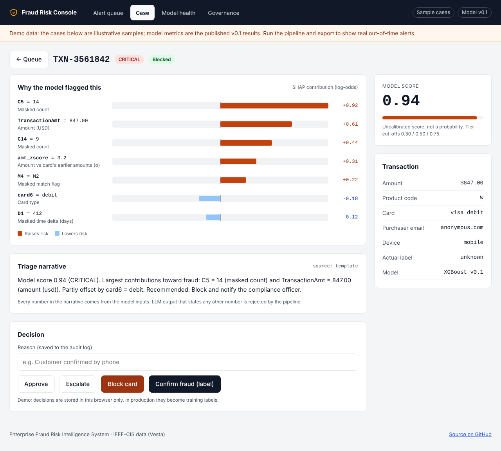
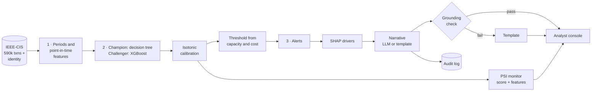
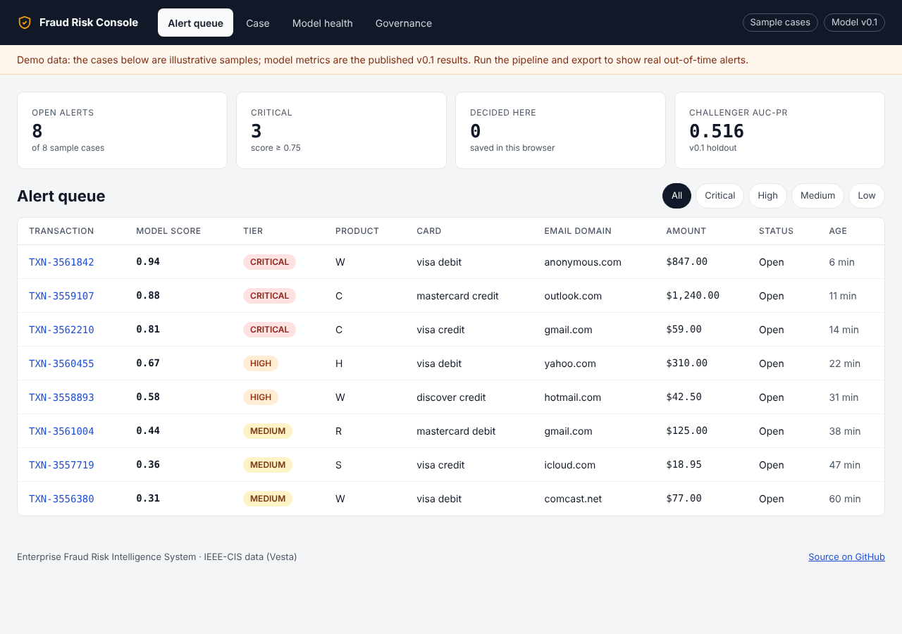
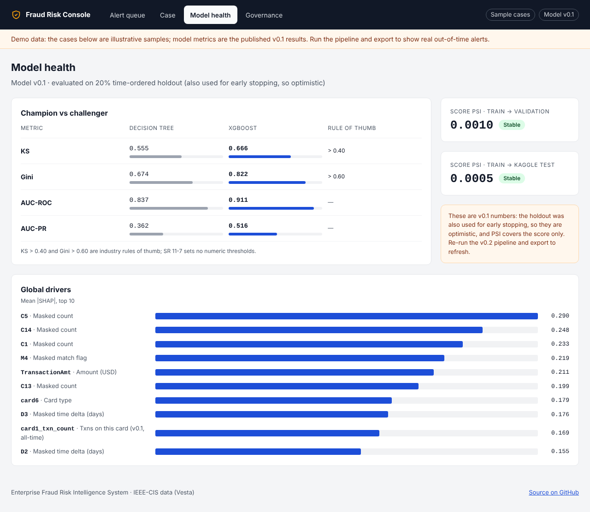

<div align="center">

# Enterprise Fraud Risk Intelligence System

**Detect → Explain → Govern.** An end-to-end card-fraud risk system built the way a bank's model risk team would review it: leakage-free validation, calibrated probabilities, an operating point tied to analyst capacity, explanations analysts can act on, and drift monitoring.

[](https://python.org)
[](https://xgboost.ai)
[](https://github.com/shap/shap)
[](#model-risk-management-mapping)
[](https://www.kaggle.com/competitions/ieee-fraud-detection)
[](LICENSE)

[**Live console**](#analyst-console) · [How it works](#how-it-works) · [Validation design](#validation-design) · [Results](#results) · [Quickstart](#quickstart)



</div>

---

## Why this project

About 3.5% of card-not-present transactions in the IEEE-CIS data are fraud. Catching them is only part of the job. A deployable fraud model also has to:

| Requirement | What this repo does |
|---|---|
| **Be measured honestly** | Three time-ordered periods; features use only the past; the out-of-time period is touched once, for the report |
| **Produce numbers people can act on** | Isotonic calibration, so a 0.80 means roughly an 80% fraud rate, not an inflated score |
| **Fit the operation** | The alert threshold is the lowest-cost one that the review team can actually work each day |
| **Explain every alert** | Per-transaction SHAP drivers in plain language, plus a narrative that is rejected if it states any number not in its input |
| **Stay trustworthy over time** | PSI on the score and the top 20 features, with review triggers |
| **Leave an audit trail** | Every narrative is logged with its prompt hash, source and model version |

## How it works



| Stage | Notebook | Output |
|---|---|---|
| Ingest, periods, features | [`01_eda_feature_engineering.py`](fraud_classifier/notebooks/01_eda_feature_engineering.py) | Feature matrices, period labels, EDA charts |
| Train, calibrate, choose threshold, explain | [`02_model_training_validation.py`](fraud_classifier/notebooks/02_model_training_validation.py) | Models, calibrators, `metrics.json`, `operating_point.json`, SHAP charts |
| Monitor, triage, report | [`03_risk_pipeline_llm_triage.py`](fraud_classifier/notebooks/03_risk_pipeline_llm_triage.py) | `psi_results.json`, `triage_cases.json`, `triage_log.jsonl`, `RESULTS.md` |
| Publish to the console | [`export_console_data.py`](fraud_classifier/scripts/export_console_data.py) | `console/data/console.json` |

## Validation design

```
TransactionDT ─────────────────────────────────────────────────────────────▶
│◀──────────────── fit 70% ────────────────▶│◀─ valid 15% ─▶│◀─ OOT 15% ─▶│
  models, encodings, null filter              early stopping   reported
                                              calibration      metrics only
                                              threshold
                                              PSI reference
```

**Decisions and why**

| Decision | Why |
|---|---|
| Card history features (7-day velocity, prior mean amount, amount z-score, time since last transaction) use only **earlier** rows | Aggregating over the whole dataset lets early transactions see their own future: classic leakage that inflates every metric |
| Encodings and the >90%-null filter are fitted on **fit** only | The same leakage, through the back door |
| `TransactionDT` is **not** a feature | It is a clock; the model would learn trends that do not carry forward |
| Early stopping on **valid**, never on OOT | Choosing the stopping point on the test period makes the test period part of training |
| A 7-day velocity window, not an all-time count | All-time counts grow with time and drift by construction |
| Isotonic calibration on **valid** | Class weighting inflates scores; monotonic calibration fixes their meaning without changing ranking metrics |
| Threshold = lowest expected cost within `ALERT_CAPACITY_PER_DAY` | A model is only as useful as the alerts a team can work |
| PSI with reference-decile bins and a missing-value bin | Fixed-width bins on a skewed score hide drift in the bins that matter |

## Results

The pipeline writes its own report to `fraud_classifier/outputs/RESULTS.md` (KS, Gini, AUC-ROC, AUC-PR and Brier for both models on the out-of-time period, the operating point, and PSI). Numbers in this README should be copied from there, not typed by hand.

> **v0.1 → v0.2.** The first version reported XGBoost KS 0.667 / Gini 0.822 / AUC-ROC 0.911 / AUC-PR ≈ 0.50 on a 20% holdout. That holdout was also used for early stopping and the card features were computed across the split, so those figures were optimistic. v0.2 fixes both; expect somewhat lower, defensible numbers. *The v0.2 table goes here after the first full run.*

**Reading the metrics:** with a 3.5% base rate, a model that predicts "legitimate" every time is 96.5% accurate, so accuracy is not reported. KS and Gini measure separation between fraud and legitimate scores; AUC-PR is the most informative single number at this base rate; Brier measures calibration. KS > 0.40 and Gini > 0.60 are industry rules of thumb, not SR 11-7 requirements.

## Analyst console

A static web console in [`console/`](console/) (no build step, Vercel-ready):

| Alert queue | Model health |
|---|---|
|  |  |

- **Alert queue:** KPIs, tier filters, click through to a case
- **Case review:** SHAP driver chart, grounded narrative, Approve / Escalate / Block / Confirm-fraud with a reason
- **Model health:** champion vs challenger, operating point, score and feature PSI, global drivers
- **Governance:** model card, validation findings, audit log

It ships with labelled sample cases and the v0.1 metrics. After a pipeline run, `python fraud_classifier/scripts/export_console_data.py` replaces them with real out-of-time alerts.

**Deploy:** Vercel → *Add New Project* → import this repo → **Root Directory `console`**, framework preset *Other*, no build command.

## Explainability and the triage layer

Each alert gets its calibrated probability, a risk tier anchored to the operating threshold, and its top SHAP drivers with plain-language meanings. Vesta masks most columns (C1–C14, D1–D15, M1–M9, V1–V339), so the feature dictionary says "masked count" rather than inventing a meaning.

The narrative is written by one configured LLM (`ANTHROPIC_API_KEY`, `TRIAGE_MODEL`) from a JSON payload of facts, or by a deterministic template when no key is set. Then:

- **Grounding check.** Every number in the narrative must appear in the payload. "C5 is 14x above the card average" is rejected unless that ratio was actually computed, and the template is used instead.
- **Audit log.** The prompt, its SHA-256, the narrative, its source and the model version are appended to `outputs/triage_log.jsonl`.

> Sending transaction features to an external model requires your organization's data-handling approval. The template path keeps everything local.

## Model risk management mapping

| SR 11-7 element | Evidence in this repo |
|---|---|
| Sound development, documented assumptions | Period design, point-in-time features, business assumptions at the top of notebook 2 |
| Independent validation and outcomes analysis | Untouched out-of-time period; discrimination, calibration and operating-point metrics |
| Conceptual soundness, explainability | Interpretable champion; per-alert SHAP; plain-language feature dictionary |
| Ongoing monitoring | Score and feature PSI with stable / monitor / review triggers |
| Effective challenge | Champion-challenger comparison on the same out-of-time period |
| Governance and controls | Grounded narratives, audit log, model card and findings in the console |

## Quickstart

```bash
git clone https://github.com/hiralsarkar/Enterprise-Fraud-Risk-Intelligence-System.git
cd Enterprise-Fraud-Risk-Intelligence-System/fraud_classifier
pip install -r requirements.txt

# Data: kaggle competitions download -c ieee-fraud-detection
#       unzip into fraud_classifier/data/ieee-fraud-detection/  (or set FRAUD_DATA_DIR)

python notebooks/01_eda_feature_engineering.py
python notebooks/02_model_training_validation.py
export ANTHROPIC_API_KEY="..."          # optional, for LLM narratives
python notebooks/03_risk_pipeline_llm_triage.py
python scripts/export_console_data.py   # refresh the console

python -m http.server -d ../console 8000   # open http://localhost:8000
```

Tune `ALERT_CAPACITY_PER_DAY`, `COST_REVIEW` and `COST_MISSED_FRAUD` at the top of notebook 2 to match your operation.

## Repository layout

```
├── fraud_classifier/
│   ├── notebooks/        01–03 pipeline (.py is the source; .ipynb is exported)
│   ├── scripts/          py_to_ipynb.py · export_console_data.py
│   ├── outputs/          metrics, charts, RESULTS.md, triage cases
│   ├── models/           trained models + calibrators (not committed)
│   └── data/             IEEE-CIS CSVs (not committed)
├── console/              static analyst console (Vercel-ready)
└── docs/images/          screenshots
```

The `.py` notebooks use percent format, so they open as notebooks in VS Code. After editing one, run `python fraud_classifier/scripts/py_to_ipynb.py`.

## Limitations

- **Public, masked data.** Most IEEE-CIS features are anonymised, which limits how much an explanation can say. Real deployments would have meaningful features.
- **Labels are final.** Real chargebacks arrive weeks later; production validation must account for label delay.
- **Batch, not real time.** Scoring runs in notebooks. A scoring service is on the roadmap.
- **Console decisions are local.** They are saved in the browser, not a system of record.

## Roadmap

- [x] Leakage-free validation, calibration, capacity-based threshold, grounded triage (v0.2)
- [x] Analyst console
- [ ] FastAPI scoring service (`/score`, `/explain`, `/triage`), tests, Docker, CI
- [ ] Customer-level keys and aggregates; LightGBM / CatBoost challengers
- [ ] Segment stability checks; scheduled drift job with PSI over time
- [ ] Console backed by the API and a database, with decisions feeding retraining labels

## Tech stack

`Python` · `pandas` · `scikit-learn` · `XGBoost` · `SHAP` · `matplotlib` · `Anthropic API` (optional) · vanilla `HTML/CSS/JS` · `Vercel`

## License

[MIT](LICENSE) © 2026 Hiral Sarkar. The IEEE-CIS dataset is provided by Vesta Corporation under the Kaggle competition rules and is not redistributed here.
